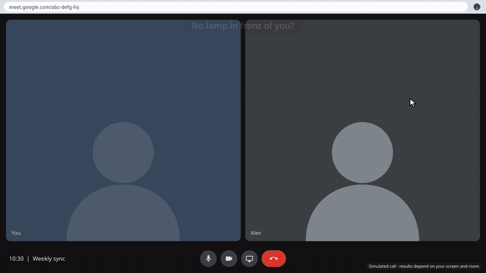
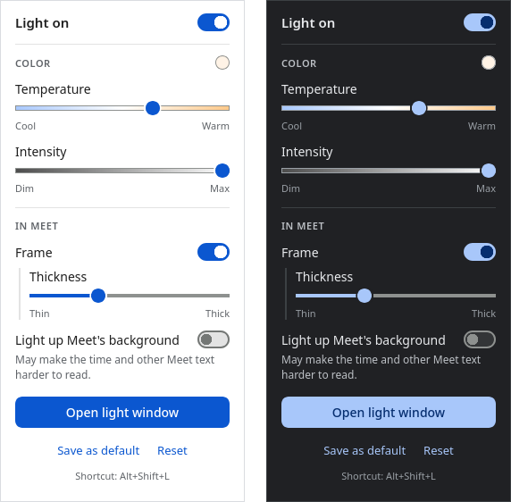
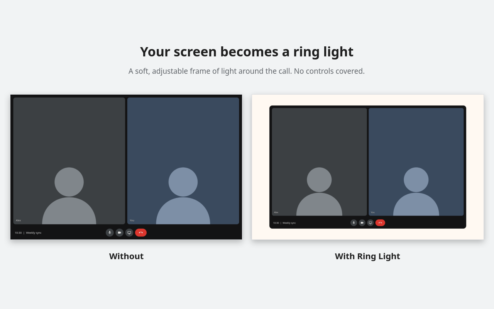
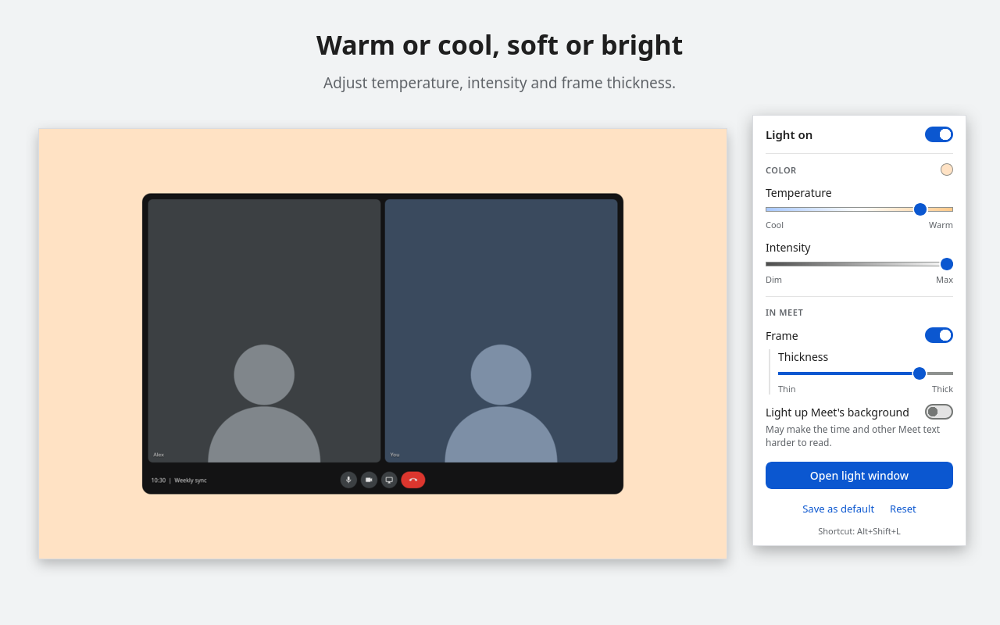
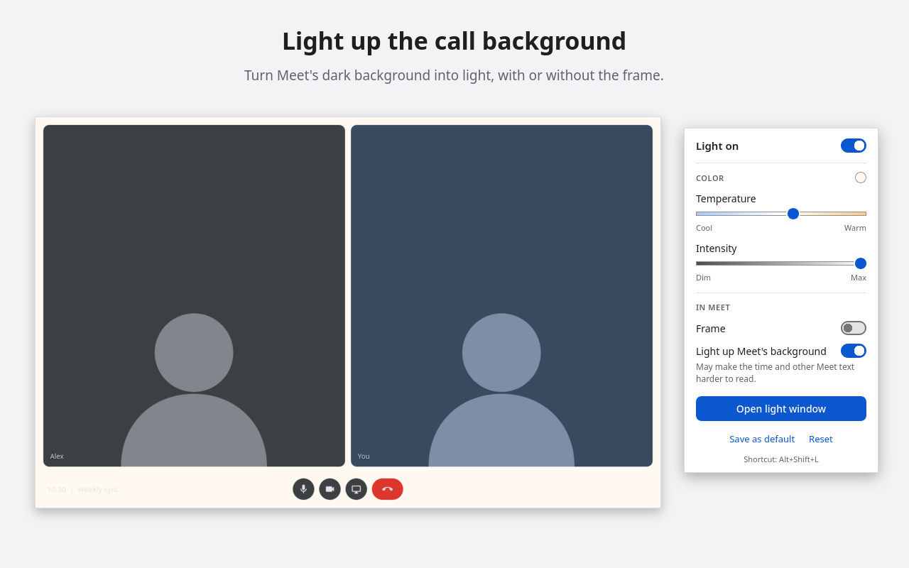
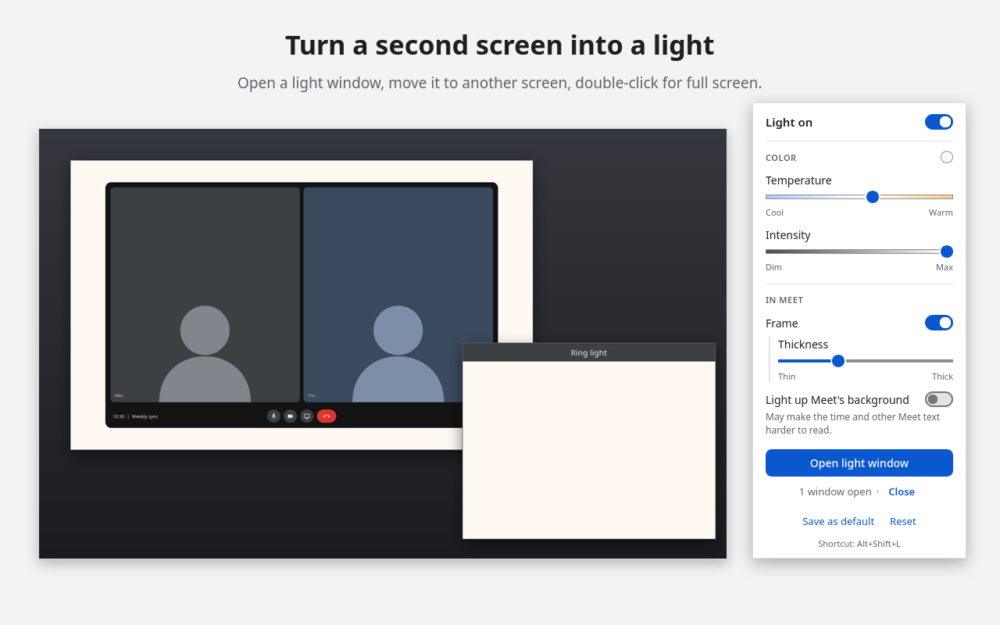

# Ring Light for Google Meet

A browser extension that turns your screen into a ring light during Google Meet calls. It frames the call with a soft, adjustable light so your face is lit even without a lamp in front of you. Works in Firefox, Chrome, Edge, Opera and Brave.

 <a href="https://youtu.be/ApHeht_c__s">Watch the full video on YouTube</a>

## Quick start

1. Install the extension (see [Install](#install)).
2. Join a Google Meet call.
3. Click the toolbar icon and turn on **Light on**, or press <kbd>Alt</kbd>+<kbd>Shift</kbd>+<kbd>L</kbd>.

The call shrinks slightly and a frame of light fills the edges of the screen. No Meet control is covered.

## Features

| Setting | What it does |
|---------|--------------|
| **Light on** | Main switch. The light only applies inside a meeting, not on the Meet home page. |
| **Temperature** | From cool (bluish) to warm (amber) light. |
| **Intensity** | From dim to full brightness. |
| **Frame** and **Thickness** | The ring of light around the call, and how wide it is. |
| **Light up Meet's background** | Turns Meet's dark call background into light too, for more brightness without a frame. |
| **Open light window** | Opens a window filled with light that you can move to a second screen. Double-click for full screen. |
| **Save as default** / **Reset** | Save your favourite settings and go back to them after experimenting. Saving and resetting can be undone. |

The toolbar icon lights up only in the tab where the light is applied. The panel follows your browser's light or dark theme and language: English, Spanish, Catalan, Galician, Basque, French, German, Italian, Portuguese (Brazil and Portugal), Japanese and Traditional Chinese. Galician works in Firefox only, because Chrome does not support it for extensions. [Help improve the translations](CONTRIBUTING.md#translations).

## Screenshots

| | |
|:-:|:-:|
|  Without and with Ring Light |  Warm or cool, soft or bright |
|  Light up Meet's dark background |  A light window for a second screen |

The call in these screenshots is a mock-up; the light effect and the panel are the real ones.

## Install

**Firefox** (128 or later): [get it on Firefox Add-ons](https://addons.mozilla.org/firefox/addon/ring-light-for-google-meet/).

**Chrome, Edge, Opera, Brave** (Chromium 121 or later): the Chrome Web Store listing is on the way. Until then, load it from source:

1. Download or clone this repository.
2. Open `chrome://extensions` (`edge://extensions`, `opera://extensions`, `brave://extensions`).
3. Turn on **Developer mode** and click **Load unpacked**, then pick the repository folder.

## Keyboard shortcut

<kbd>Alt</kbd>+<kbd>Shift</kbd>+<kbd>L</kbd> turns the light on and off. To change it:

- Firefox: `about:addons` → gear menu → **Manage Extension Shortcuts**.
- Chromium browsers: `chrome://extensions/shortcuts`.

## Known limitations

- On Meet's "You left the meeting" screen the light stays on, because Meet keeps the same address.
- **Light up Meet's background** finds Meet's dark areas by colour and size, so it may stop working if Google redesigns Meet. It can also light the tiles of participants with their camera off.
- The settings panel closes when the light window opens. Browsers close extension panels when they lose focus; open the panel again to keep adjusting.

## Roadmap

Support for other video call apps that run in the browser is planned: Microsoft Teams, Zoom and Jitsi Meet. [Vote with 👍 or help on issue #1](https://github.com/acasaism/ring-light/issues/1).

## Privacy

The extension collects no data and makes no network requests. Your settings stay in your browser. See [PRIVACY.md](PRIVACY.md).

## Contributing

Bug reports and pull requests are welcome. See [CONTRIBUTING.md](CONTRIBUTING.md) to set up the project and run the tests.

## License

[MIT](LICENSE)
